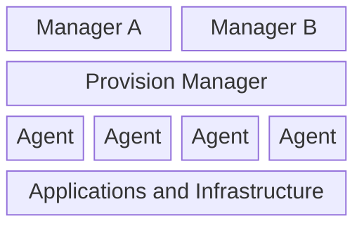
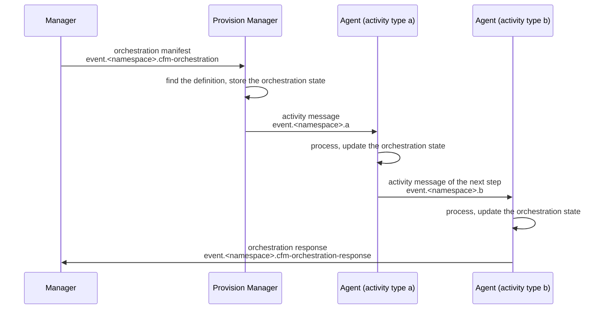

# CFM System Architecture

## Introduction

This document defines the overall system architecture for the Component Fabric Manager (CFM). The CFM is a generic
orchestration engine: a platform for executing stateful workflows, called _**orchestrations**_, that provision and
manage resources in a multitenant environment. A resource can be anything that can be automated, for example a
configuration entry in an application, a cloud service, a credential, or a network route.

The CFM does not define which resources exist or how they are provisioned. It defines how the work is described,
ordered, executed reliably and isolated between the parties that use it. The domain is added by components that build
on the engine:

**Logical Systems Architecture**

The CFM is composed of the following parts:

- The **Provision Manager (PM)** which executes stateful orchestrations. It is the engine, and the only runtime in this
  repository.
- **Managers** which own a domain model and ask the Provision Manager to run orchestrations. A manager is not part of
  the engine. The Tenant Manager of [cfm-dataspace](https://github.com/eclipse-cfm/cfm-dataspace) is one.
- **Activity Agents** that execute the tasks of an orchestration against applications and infrastructure. The engine
  provides the framework for agents; the agents themselves belong to a domain.

The CFM is designed as a reliable message-based system that can be extended and deployed to diverse cloud and on-premise
environments. Its design is simple; at a minimum it requires only a messaging system (NATS is the default), and a
Postgres database for durable definitions.

## A Generic Engine

The engine has no notion of what an orchestration is about. Its model consists of a few concepts:

| Concept                      | Description                                                                                                                             |
|------------------------------|-----------------------------------------------------------------------------------------------------------------------------------------|
| **Activity definition**      | Declares an activity type, with the schema of its input and its output                                                                  |
| **Orchestration definition** | Declares an orchestration type: the activities it runs, their dependencies, the schema of its input, and the type that compensates it   |
| **Orchestration manifest**   | The request of a manager to run an orchestration of a type, with a payload                                                              |
| **Orchestration**            | A running or finished instance, with its state and the data its activities share                                                        |
| **Orchestration response**   | The outcome of an orchestration, with the output values of its activities, sent to the manager                                          |
| **Namespace**                | The space of one manager. Definitions, orchestrations, messages and API access are kept apart by namespace                              |

The types are free-form strings chosen by whoever registers the definitions, and the payload of a manifest is an
arbitrary JSON object that the engine passes to the activities without interpreting it. A domain is therefore built on
the engine by adding, not by changing it:

- **A manager** owns the domain model and its API. It decides when an orchestration is needed, sends a manifest and
  applies the response to its model. It can talk to the engine over NATS or over the REST API.
- **Orchestration and activity definitions** describe the workflows of the domain. They are data, registered through
  the REST API.
- **Activity agents** implement the activity types of the domain as `ActivityProcessor`s on the agent framework
  ([`pmanager/natsagent`](../../../pmanager/natsagent)).
- **Lifecycle agents** react to events of the domain that are not part of an orchestration, on the lifecycle agent
  framework ([`common/lifecycleagent`](../../../common/lifecycleagent)).
- **A namespace** gives the manager and its agents a space of their own, so that several domains can share one
  Provision Manager instance, see [Namespaces](../namespaces.md).

The dependency only points one way: the engine must not import a component that builds on it. For the dataspace
components this is enforced by the `depguard` rule in [`.golangci.yml`](../../../.golangci.yml).

The [samples](../../../samples/README.md) contain a manager, an agent and definitions for a made-up domain.

### The Dataspace Variant: CFM-Dataspace

The CFM was first built to deploy and manage dataspace-related (connector) resources: control planes, data planes,
credential services and issuer services that are virtualized per participant. This is now the dataspace-specific
variant of the CFM, maintained in [eclipse-cfm/cfm-dataspace](https://github.com/eclipse-cfm/cfm-dataspace). It uses
the extension points above as follows:

| Extension point  | In cfm-dataspace                                                                                                              |
|------------------|-------------------------------------------------------------------------------------------------------------------------------|
| Manager          | The **Tenant Manager** (`tmanager`), which manages tenants, participant profiles, cells and dataspace profiles                |
| Domain model     | The `dataspace` package, with the Virtual Participant Agent (VPA) and the orchestration types that deploy and dispose VPAs    |
| Activity agents  | `agent/orchestration`: agents for EDC-V, IdentityHub, registration, onboarding and others                                     |
| Lifecycle agents | `agent/lifecycle`: for example the key management agent                                                                       |
| Namespace        | `default`. The Tenant Manager does not name a namespace, so it uses the subjects and the API routes of the default namespace  |

The service virtualization model of the dataspace variant, with tenants, participant profiles, VPAs and cells, is
described in the
[cfm-dataspace documentation](https://github.com/eclipse-cfm/cfm-dataspace/blob/main/docs/architecture/service.virtualization.md).

A deployment can run the dataspace variant alone, another domain alone, or both against the same Provision Manager in
separate namespaces.

## Message Flow

A manager and the agents never call each other. They are connected through the Provision Manager and the messaging
system:

1. The manager sends an orchestration manifest, on the subject of its namespace or through the REST API.
2. The Provision Manager looks up the orchestration definition of the manifest's type in the namespace, orders its
   activities into steps, stores the orchestration state in the key-value bucket and enqueues the activities of the
   first step.
3. The agent of an activity type receives the activity message, runs its `ActivityProcessor` and updates the
   orchestration state. When all activities of a step are complete, the executor in the agent enqueues the activities
   of the next step.
4. The executor that completes the last activity, or that records a fatal error, publishes the orchestration response
   for the manager.
5. If the orchestration failed and its definition names a compensation type, the Provision Manager starts the
   compensating orchestration, see [Compensation and reconciliation](../compensation.md).

## CFM Subsystems

The CFM platform is designed as a message-based system built on an extensible messaging middleware for reliable,
asynchronous communication. This architecture enables temporal and spatial decoupling between independent subsystems,
allowing them to operate autonomously without direct dependencies.

### NATS Jetstream

The default messaging middleware is [NATS Jetstream](https://docs.nats.io/nats-concepts/jetstream), which provides
persistence, durability, and guaranteed delivery. Messages are published to named
subjects and persisted in streams, ensuring no message loss even if consumers are temporarily unavailable. This
reliability is essential for orchestration workflows that may span multiple stages and infrastructure environments.

### System Modularity: The Service Assembler

The `ServiceAssembler` is the core modularity system that composes CFM runtimes from discrete modules. The assembler
enables the decomposition of system functionality into self-contained modules, or `service assemblies`, that declare
their dependencies and provided services.

Each service assembly implements the `ServiceAssembly` interface, which defines:

- **Name**: A unique identifier for the component
- **Provides**: The set of service types or capabilities this component exports and makes available to other assemblies
- **Requires**: The set of service types or capabilities this component depends on from other assemblies
- **Lifecycle operations**: `Init`, `Prepare`, `Start`, `Finalize`, and `Shutdown` sequences for coordinated component
  initialization and teardown

#### Assembly Loading and Service Resolution

The `ServiceAssembler` manages the registration, dependency resolution, and initialization of service assemblies when
the system boots:

1. **Registration**: All assemblies are registered with the assembler. Each assembly declares the services it provides
   and the services it requires.

2. **Dependency Analysis**: The assembler constructs a directed acyclic graph based on the `Provides` and `Requires`
   declarations
   from all registered assemblies. This graph represents the relationships between service requirements and their
   providers.

3. **Topological Ordering**: The dependency graph is sorted topologically, ensuring assemblies are initialized in an
   order that satisfies all dependency constraints. This ordering determines the sequence in which assemblies transition
   through their lifecycle phases.

4. **Service Registry**: During the initialization phase, each assembly receives an `InitContext` containing a
   `ServiceRegistry`. Assemblies use this registry to:
    - Register concrete service instances they provide
    - Resolve and retrieve service instances provided by other assemblies
    - Share cross-cutting concerns and shared infrastructure

5. **Lifecycle Coordination**: Assemblies transition through their lifecycle stages in dependency order:
    - **Init**: Assemblies register their services in the registry and perform initialization logic
    - **Prepare**: Assemblies perform secondary setup after all services are registered
    - **Start**: Assemblies begin active operations
    - **Finalize**: Assemblies perform cleanup before shutdown
    - **Shutdown**: Assemblies perform final resource cleanup and termination

This dependency-driven approach ensures that services are always initialized in order and that all required
dependencies are available when an assembly boots.

#### Modular Architecture

The system uses a structured directory layout organized by concern and functionality. Shared functionality is
centralized in the `/common` directory, which provides cross-cutting utilities including:

- Collection abstractions and data structure implementations
- DAG (Directed Acyclic Graph) implementation used for topological dependency ordering
- Storage abstraction layers (memory and SQL-backed implementations)
- Message client integrations (NATS)
- Query and handler implementations
- Type definitions and runtime models

The `/assembly` directory contains shared service assemblies that every CFM runtime can use. They provide capabilities
such as an HTTP client, HTTP request routing, API authentication and health endpoints.

#### Service Type Registry

Services are identified using `ServiceType` keys, which provide a type-safe mechanism for service discovery and
resolution. These keys decouple assembly implementations from direct dependencies on concrete types. When an assembly
requires a service, it specifies the required `ServiceType`, and the registry resolves the actual implementation at
runtime. This allows for multiple implementations of the same service interface to coexist in different deployment
configurations.

### Provision Manager

The Provision Manager implements asynchronous orchestration by executing stateful workflows defined through
`OrchestrationDefinition` entities. The orchestration architecture is
described [here](./provisioning/orchestrator.design.md).

The Provision Manager provides a REST API under `/api/v1alpha1` for managing activity definitions and orchestration
definitions, and for starting, reading and querying orchestrations. The API is described in
[`pmanager/docs/openapi.json`](../../../pmanager/docs/openapi.json). Access is authorized with OAuth2 access tokens
whose scopes name a permission (`read`, `write` or `admin`) and optionally a namespace. Orchestrations can be queried
using the CFM predicate-based [query language](./query/cfm.query.language.md).

Definitions and the orchestration index are stored in Postgres, or in memory when Postgres is not configured. The state
of an orchestration is stored in a NATS JetStream key-value bucket, where the agents update it.

### Managers

A manager initiates orchestrations and consumes their results. The engine provides no manager; it defines the contract
a manager uses:

- The manager sends an `OrchestrationManifest` (`common/model`) to the subject `event.<namespace>.cfm-orchestration`,
  or posts it to the REST API.
- The Provision Manager, or the agent that completes the orchestration, publishes an `OrchestrationResponse` to
  `event.<namespace>.cfm-orchestration-response`, or to the subject of the `replyTo` token of the manifest. The
  `replyTo` token lets several initiators in one namespace receive their own responses.
- A manifest ID identifies an orchestration in its namespace. Sending the same manifest again does not start a second
  orchestration.

A manager that does not name a namespace works in the namespace `default`.

### Activity Agents

Activity agents asynchronously process orchestration steps by receiving messages sent by the Provision Manager. Agents
are temporally and spatially decoupled from the provisioner through NATS. Agents isolate infrastructure secrets and
access from the provisioning manager. This results in bounded security contexts, even within an orchestration.

An agent executes the activities of one activity type in one namespace. It is built by passing an `ActivityProcessor`
to the agent launcher in `pmanager/natsagent`, see [Activity Agents](./provisioning/orchestrator.design.md#activity-agents).

### Lifecycle Agents

Lifecycle agents react to domain events that are not part of an orchestration, for example the rotation of a key. The
events are delivered as [CloudEvents](https://cloudevents.io/) on NATS JetStream subjects. The framework in
`common/lifecycleagent` connects an `EventProcessor` to the configured subjects with a durable consumer. See the
[decision record](../decision_records/2026-06-26-lifecycle-agents/README.md).
